# EduRate: Professor Rating and Performance Analytics System

## Cover Information

- **Project Title:** EduRate - Professor Rating and Performance Analytics System
- **Course:** Project-I (CSE3021)
- **Submitted By:** MOHIT GORA
- **Roll Number:** 230101056
- **Semester:** VII
- **Department:** Department Of Computer Science And Engineering
- **Institute:** Indian Institute of Information Technology Senapati, Manipur
- **Supervised By:** Dr. Sanasam Chanu Inunganbi
- **Submission Date:** ____________________

### Institute Logo

22/iiit%20manipur.png)

---

## Declaration

I hereby declare that this project report titled **"EduRate: Professor Rating and Performance Analytics System"** is my original work and has been prepared by me for academic submission. All references, ideas, and resources used from other works have been appropriately acknowledged.

---

## Abstract

EduRate is a full-stack web-based platform designed to improve transparency and quality in higher-education teaching feedback systems. The platform provides role-based access for students, professors, and administrators, enabling students to rate faculty members, post academic doubts, and use a performance prediction module for expected exam outcomes. Professors receive structured feedback and can answer student doubts, while administrators can monitor institutional teaching performance and send automated email-based performance reports.

The system is implemented using HTML, CSS, JavaScript, Node.js, Express.js, MySQL, JWT authentication, and Chart.js for analytics visualization. Core modules include secure authentication, professor rating management, daily-limited doubt posting, performance trend analytics, and an AI-inspired prediction engine based on weighted factors and regression blending. The platform is designed for usability, modularity, and future scalability toward advanced educational analytics.

---

## Acknowledgement

I would like to express my sincere gratitude to my project supervisor **`Dr. Sanasam Chanu Inunganbi`** for valuable guidance, continuous support, and insightful suggestions throughout the development of this project.

I am also thankful to the faculty members of the Department of Computer Science and Engineering, IIIT Senapati, Manipur, for their encouragement and technical input. Finally, I extend heartfelt thanks to my family and friends for their constant motivation during this project.

---

## Table of Contents

1. Introduction  
2. Literature Survey  
3. Requirement Engineering  
4. System Design  
5. Implementation  
6. Results and Screenshots  
7. Conclusion and Future Scope  

---

## Chapter 1: Introduction

### 1.1 Overview

EduRate is an educational feedback and analytics platform aimed at digitizing and improving the process of professor evaluation in academic institutions. It combines conventional rating features with modern analytics and admin-level insights to create a practical decision-support system.

### 1.2 Background and Motivation

Traditional feedback systems in many institutions are periodic, manual, and often inaccessible for timely action. There is a need for:

- continuous and structured student feedback,
- easy interaction between students and professors beyond classroom hours,
- transparent analytics for administrative review,
- data-driven performance insights for both students and faculty.

EduRate addresses these needs through a unified dashboard-based application.

### 1.3 Problem Statement

Existing systems generally fail to provide:

- real-time multi-role interaction among students, faculty, and admins,
- integrated analytics for ranking and trend monitoring,
- secure and role-based access control,
- actionable insights such as performance prediction and automated reporting.

### 1.4 Objectives

The main objectives of EduRate are:

- to implement secure user authentication and role-based authorization,
- to build a structured professor rating and review platform,
- to provide a doubt-resolution channel with posting controls,
- to offer performance prediction and historical trend visualization for students,
- to provide admin-side analytics and automated performance email reporting.

### 1.5 Scope and Significance

The platform can be deployed in colleges and universities for:

- semester-wise quality monitoring of teaching,
- identifying top-performing and underperforming faculties,
- collecting student sentiment in a controlled format,
- improving student preparation through data-based self-analysis tools.

---

## Chapter 2: Literature Survey

### 2.1 Existing Approaches

Most feedback portals provide static forms submitted once per semester. Some standalone systems provide ratings but lack:

- integrated professor profiles,
- moderation and abuse filtering,
- dynamic analytics and visualization,
- administrative automation features.

### 2.2 Gap Analysis

Key gaps identified:

- low feedback frequency and delayed evaluation cycles,
- no linkage between feedback and administrative intervention,
- lack of predictive analytics for student outcomes,
- isolated tools for rating, communication, and reporting.

### 2.3 Proposed Improvement

EduRate integrates these isolated functions into one platform with:

- unified login and dashboard,
- live rating and ranking view,
- doubt posting and answering workflows,
- chart-based trend analysis,
- admin-triggered performance email communication.

---

## Chapter 3: Requirement Engineering

### 3.1 Functional Requirements

1. User registration and login with role support (`student`, `professor`, `admin`).  
2. Student rating module with stars and textual feedback.  
3. Professor listing, profile display, and ranking module.  
4. Doubt module where students can post and professors can answer.  
5. Daily posting constraints for doubt management (max 2 doubts/day per student).  
6. Student performance predictor with history and trend chart.  
7. Admin dashboard for teacher performance metrics and communication.  
8. Email report generation and bulk/individual sending to faculty.

### 3.2 Non-Functional Requirements

- **Performance:** Responsive dashboard and efficient query handling.  
- **Security:** JWT-based authentication, password hashing with bcrypt.  
- **Usability:** Simple UI with tab-based navigation and clear workflows.  
- **Reliability:** Persistent storage in MySQL and local browser persistence where needed.  
- **Scalability:** Modular backend APIs and separable frontend modules.

### 3.3 User Roles

- **Student:** Rate professors, post doubts, view prediction analytics.  
- **Professor:** View ratings, answer doubts, receive performance reports.  
- **Admin:** Monitor all professor stats, rankings, and send performance emails.

---

## Chapter 4: System Design

### 4.1 Architecture Overview

EduRate follows a client-server architecture:

- **Frontend:** HTML, CSS, JavaScript
- **Backend:** Node.js + Express.js
- **Database:** MySQL
- **Authentication:** JWT + bcrypt
- **Visualization:** Chart.js

### 4.1.1 System Architecture Diagram

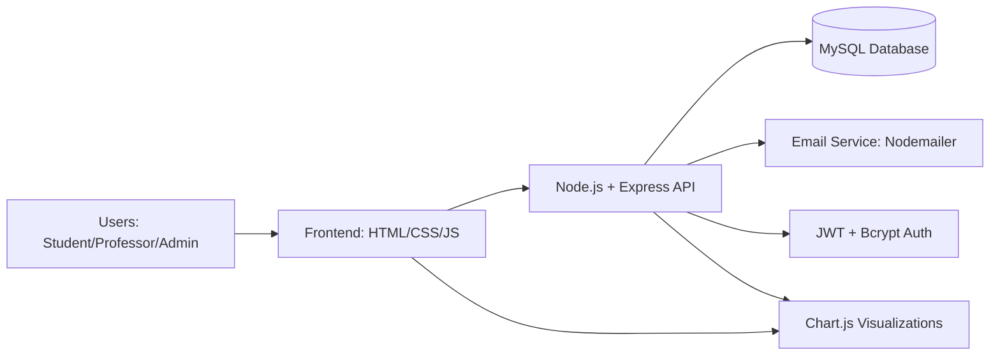

### 4.2 Major Modules

1. **Authentication Module**
   - Login and registration APIs
   - JWT token generation and verification
   - Role-based page access control

2. **Professor and Rating Module**
   - Professor listing and profile display
   - Rating submission and aggregation
   - Top performer and top-10 ranking

3. **Doubt Management Module**
   - Student doubt submission
   - Professor response workflow
   - Daily limit enforcement

4. **Performance Prediction Module**
   - Multi-step form for data input
   - Weighted score calculation
   - Regression-assisted refinement using prior entries
   - Prediction history and chart visualization

5. **Admin Analytics Module**
   - Teacher performance summary
   - Ranking dashboard
   - Individual and bulk email report dispatch

### 4.3 Database Design Summary

Main tables:

- `users`
- `professors`
- `ratings`
- `doubts`
- `gifts`
- `sessions`

Analytical views:

- `professor_ratings`
- `top10_professors`
- `student_daily_doubts`

### 4.4 DFD Level 0 (Context Diagram)

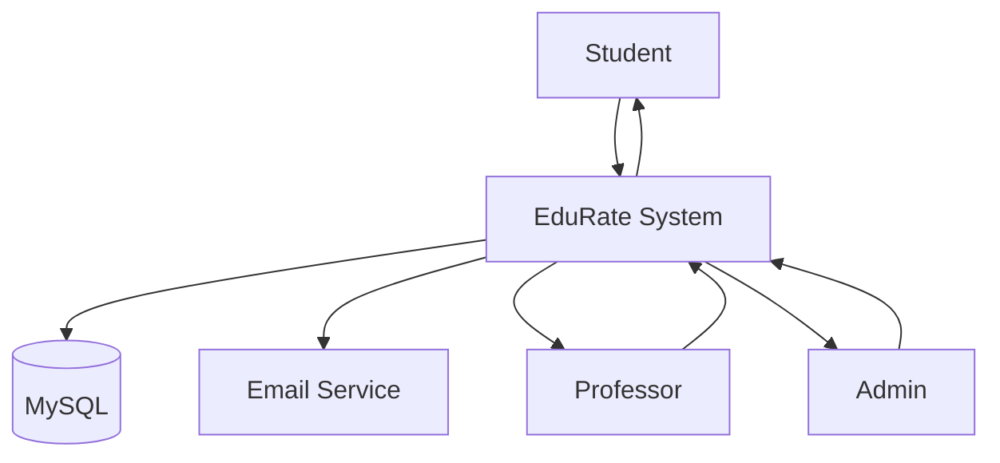

### 4.5 DFD Level 1

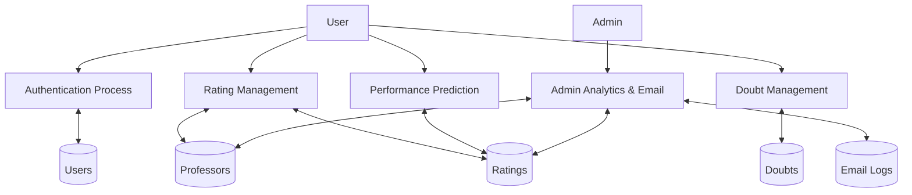

### 4.6 ER Diagram

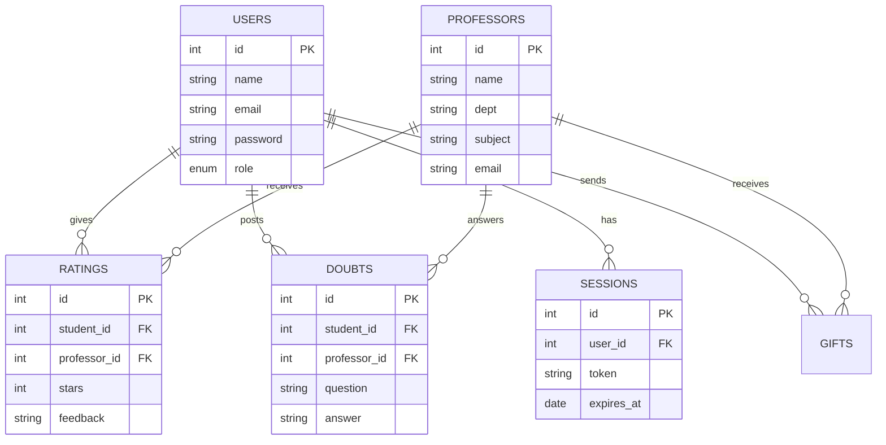

### 4.7 Use Case Diagram

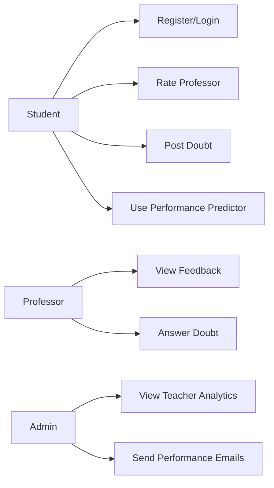

### 4.8 Sequence Diagram (Rating Submission)

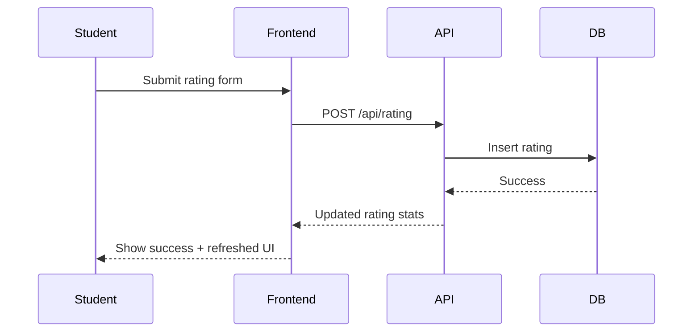

---

## Chapter 5: Implementation

### 5.1 Technology Stack

- **Frontend:** HTML5, CSS3, JavaScript (Vanilla)
- **Backend:** Express.js, Node.js
- **Database:** MySQL
- **Security:** `jsonwebtoken`, `bcryptjs`
- **Email Service:** `nodemailer`
- **Visualization:** `chart.js`

### 5.2 Backend Highlights

- `/api/auth/login` and `/api/auth/register` for secure authentication.
- Protected APIs using `authMiddleware`.
- Admin-only endpoints for:
  - professor performance retrieval,
  - top performers,
  - sending performance emails.
- Trend endpoint for rating-over-time analysis:
  - `/api/professor/:id/trend`

### 5.3 Frontend Highlights

- Multi-role dashboard UX.
- Performance tab with integrated prediction form.
- Prediction history table with complete field visibility.
- Dynamic line-chart generation for trend analysis.
- Admin dashboard UI for real-time analytics and communication.

### 5.4 Prediction Algorithm Summary

EduRate uses a hybrid prediction technique:

- weighted formula using study behavior and academic indicators,
- regression model (when enough historical records exist),
- blended output for improved expected score prediction.

Output format:

- **Expected Score: X / 10**

---

## Chapter 6: Results and Screenshots

### 6.1 Login Interface

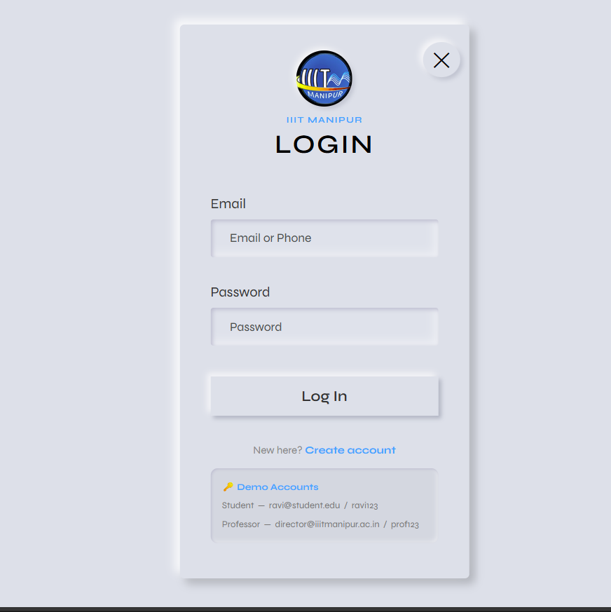

### 6.2 Registration Interface

### 6.3 Student Dashboard

### 6.4 Main Menu / Navigation

### 6.5 Doubt Module

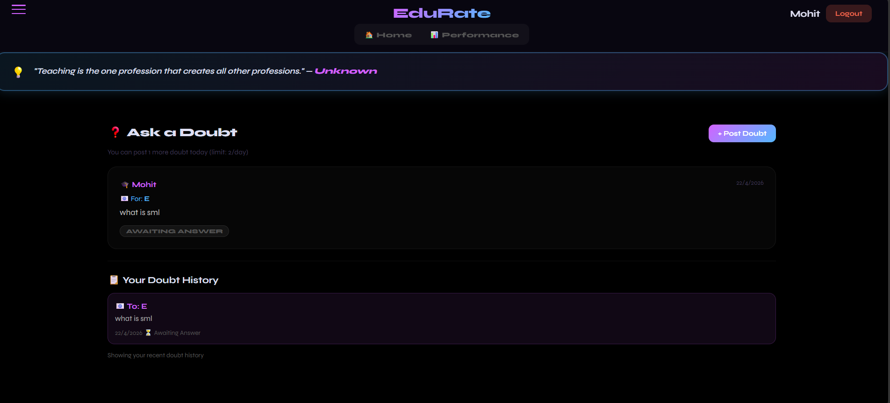

### 6.6 Performance Predictor Form

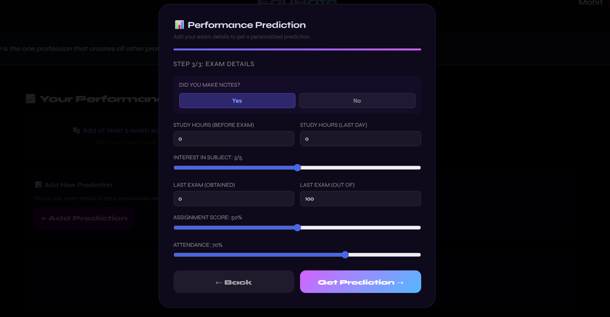

### 6.7 Prediction Output View

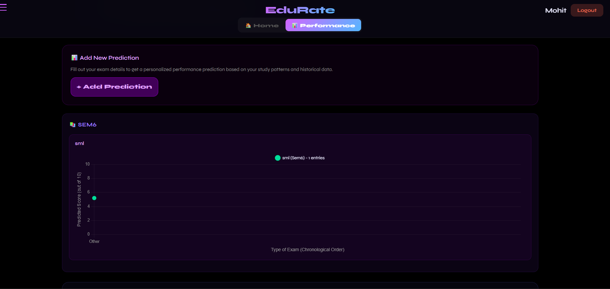

### 6.8 Admin Dashboard

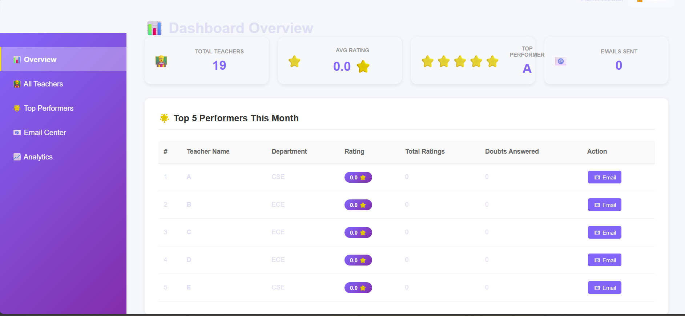

### 6.9 Observed Outcomes

- Students can submit and track academic predictions effectively.
- Faculty performance is measurable via rating and engagement metrics.
- Admin workflow for reporting is significantly simplified through automated emails.
- Chart-based trend visualization improves interpretability of prediction history.

---

## Chapter 7: Conclusion and Future Scope

### 7.1 Conclusion

EduRate successfully demonstrates a complete educational feedback and analytics system with secure authentication, role-based workflows, real-time rating aggregation, doubt resolution, and performance prediction. The integration of admin analytics with automated email reporting makes the platform practical for institutional deployment and periodic quality review.

The project meets its design goals of usability, modularity, and extensibility while delivering meaningful value to students, faculty, and administrators.

### 7.2 Future Scope

- Integrate prediction and feedback history fully with backend database (instead of local-only persistence for selected modules).
- Add semester-based report export in PDF format.
- Introduce periodic rating reset and archival automation.
- Add notification service for doubt responses and admin announcements.
- Include AI-based sentiment analysis for textual student feedback.
- Add comparative department-level analytics and longitudinal trend forecasting.

---

## References

1. Node.js Documentation - [https://nodejs.org](https://nodejs.org)  
2. Express.js Documentation - [https://expressjs.com](https://expressjs.com)  
3. MySQL Documentation - [https://dev.mysql.com/doc](https://dev.mysql.com/doc)  
4. Chart.js Documentation - [https://www.chartjs.org/docs](https://www.chartjs.org/docs)  
5. JWT Introduction - [https://jwt.io/introduction](https://jwt.io/introduction)  
6. Bcrypt.js - [https://www.npmjs.com/package/bcryptjs](https://www.npmjs.com/package/bcryptjs)
